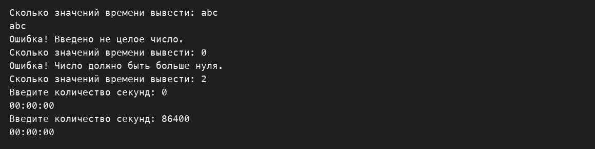
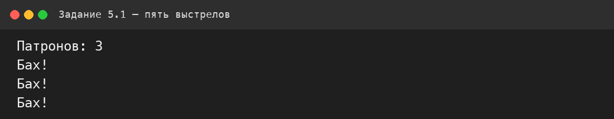
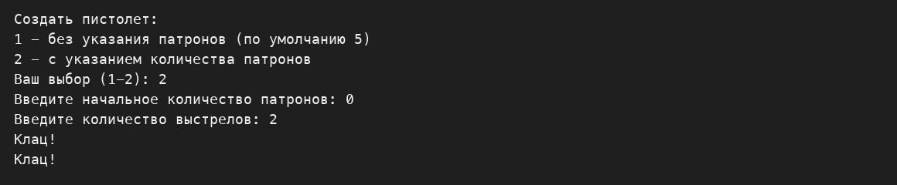

# Козарчук Никита ИТ-2 Лабораторная №2

В отчёте описан текущий код проекта. Демонстрационные объекты создаются
в методе `Main`, после чего результаты сразу выводятся в консоль.
Программа выполняет задачи варианта 6 в последовательном порядке.

# Задание 1

## Задача 4

### Текст задачи

Создать сущность «Время», которая описывается числом секунд,
прошедших с начала суток. Объект должен возвращать текстовую форму
в формате «ЧЧ:ММ:СС». Если общее время больше 24 часов, необходимо
показывать время, прошедшее с начала последних суток. Вывести время для
10, 10000 и 100000 секунд.

### Алгоритм решения

В методе `ToString()` сначала беру остаток от деления количества секунд
на 86400. Затем отдельно нахожу часы, минуты и секунды и соединяю их
в одну строку. Для каждого значения используется формат из двух цифр.

### Тестирование

Проверка 1. 10 секунд.


Проверка 2. 10000 секунд.



Проверка 3. 100000 секунд.


## Задача 5

### Текст задачи

Создать сущность «Дом», которая описывается количеством этажей.
Текстовая форма должна иметь вид «дом с N этажами» с правильным
окончанием слова. Создать и вывести дома с 1, 5 и 23 этажами.

### Алгоритм решения

Сначала выбираю окончание «этажами». Если последняя цифра равна 1,
использую «этажом». Для остальных значений в этой программе используется
форма «этажами». Количество этажей хранится в поле объекта.

### Тестирование

Проверка 1. Один этаж.


Проверка 2. Пять этажей.


Проверка 3. Двадцать три этажа.


# Задание 2

## Задача 4

### Текст задачи

Создать сущности «Сотрудник» и «Отдел». У отдела есть название и
начальник, который также является сотрудником. Сотрудник должен
выводиться в форме «Имя работает в отделе Название, начальник которого
Имя». Для начальника используется форма «Имя начальник отдела Название».
Создать Петрова, Козлова и Сидорова в отделе IT и назначить Козлова
начальником.

### Алгоритм решения

Сначала создаю сотрудников, затем отдел IT с начальником Козловым.
Через свойство `Department` добавляю каждого сотрудника в этот отдел.
Метод `ToString()` проверяет, является ли сотрудник начальником, и выводит
подходящий вариант строки.

### Тестирование

Проверка 1. Петров.


Проверка 2. Козлов.


Проверка 3. Сидоров.


# Задание 3

## Задача 4

### Текст задачи

Изменить решение задачи 2.4 так, чтобы по ссылке на сотрудника можно
было получить список всех сотрудников его отдела.

### Алгоритм решения

У сотрудника хранится ссылка на отдел. Метод `GetDepartmentEmployees()`
проверяет наличие отдела и возвращает его список сотрудников. В главном
методе список выводится циклом.

### Тестирование

Проверка 1. Список через Петрова.


Проверка 2. Список через Козлова.


Проверка 3. Список через Сидорова.


# Задание 4

## Задача 3

### Текст задачи

Изменить сущность «Дом». Дом создаётся только с указанием количества
этажей. После создания количество этажей нельзя изменить. Создать дома
с 2, 35 и 91 этажом и продемонстрировать невозможность изменения
количества этажей.

### Алгоритм решения

Количество этажей хранится в закрытом поле. Свойство `Floors` содержит
только `get`, поэтому присвоить ему новое значение после создания объекта
нельзя. В программе это дополнительно показано сообщением.

### Тестирование

Проверка 1. Два этажа.


Проверка 2. Тридцать пять этажей.


Проверка 3. Девяносто один этаж.


# Задание 5

## Задача 1

### Текст задачи

Создать сущность «Пистолет» с количеством патронов. Пистолет можно
создать с начальным количеством патронов или без параметров. В последнем
случае он изначально заряжен пятью патронами. При выстреле нужно вывести
«Бах!», если патроны есть, и уменьшить их количество. Если патронов нет,
вывести «Клац!». Создать пистолет с тремя патронами и выстрелить из него
пять раз.

### Алгоритм решения

Метод `Shoot()` проверяет поле `bullets`. Если оно больше нуля, выводится
«Бах!» и значение уменьшается на единицу. Когда значение стало равно
нулю, каждый следующий выстрел выводит «Клац!». Есть также конструктор
без параметров, который задаёт пять патронов.

### Тестирование

Проверка 1. Первые три выстрела.



Проверка 2. Все пять выстрелов.



Проверка 3. Выстрелы после окончания патронов.


# Запуск

```bash
dotnet run --project Lab2.csproj
```
